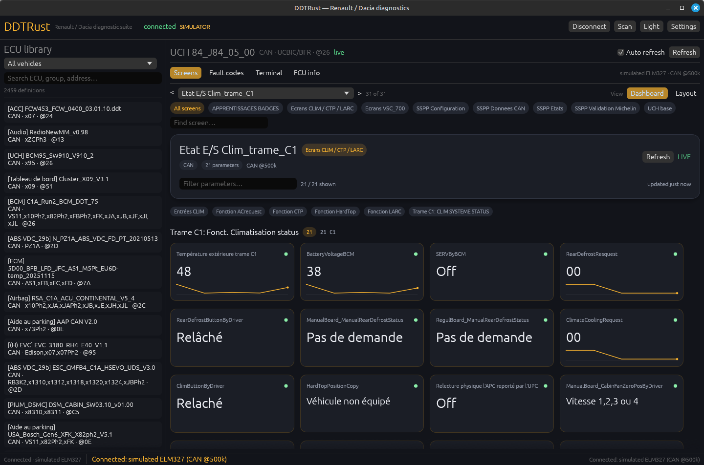
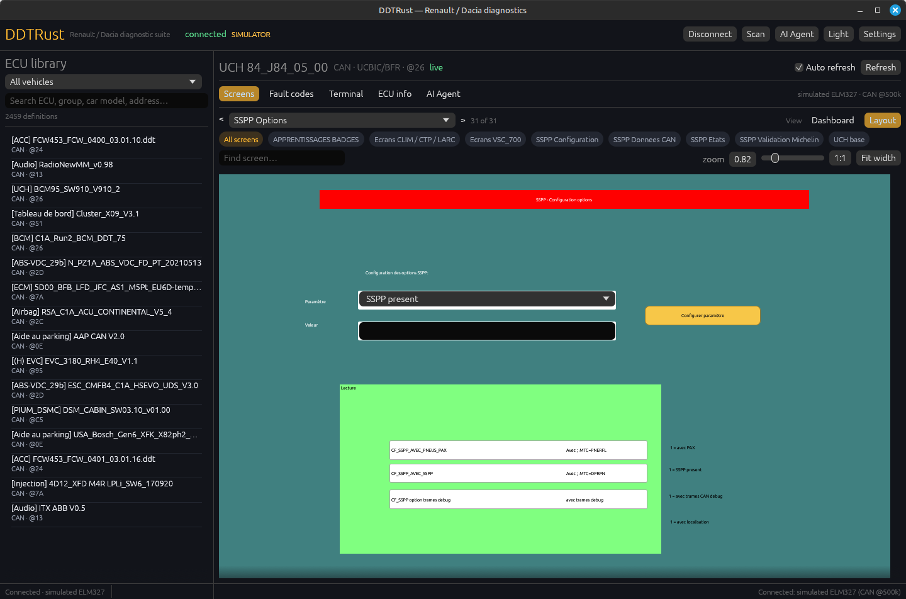
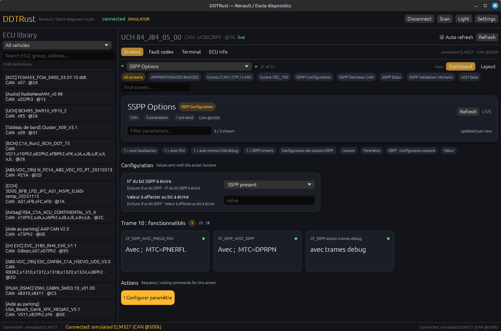
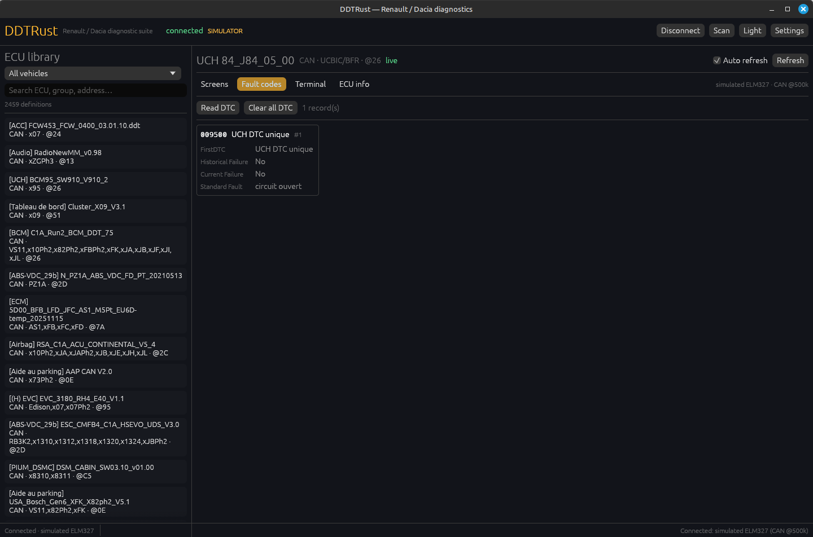
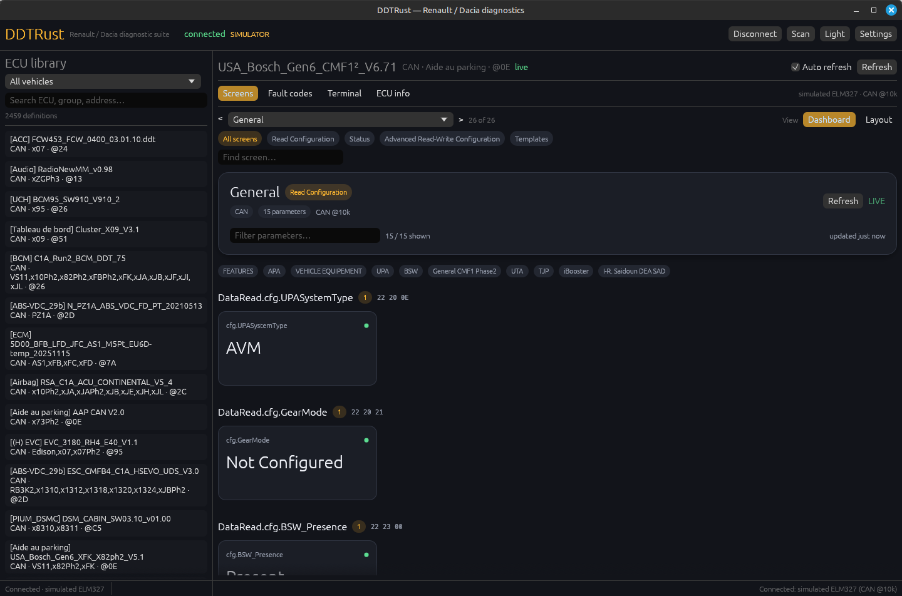
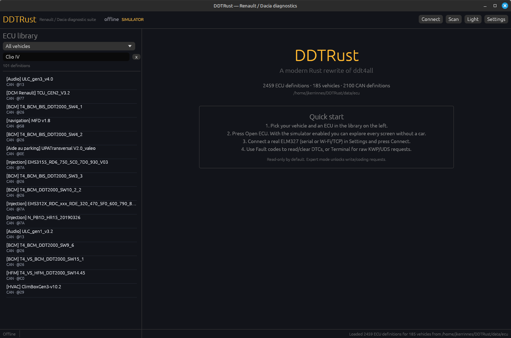
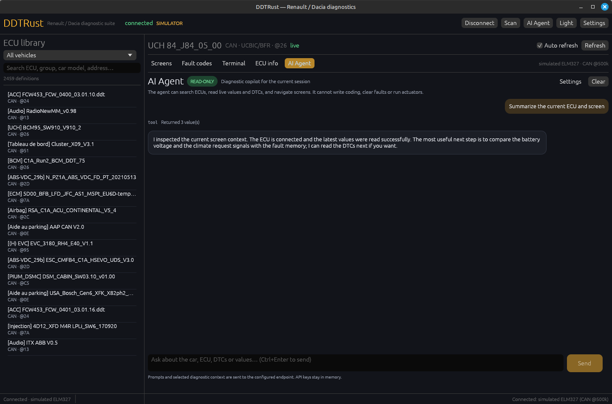
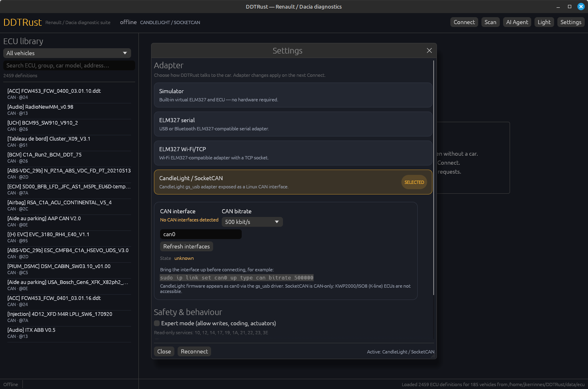
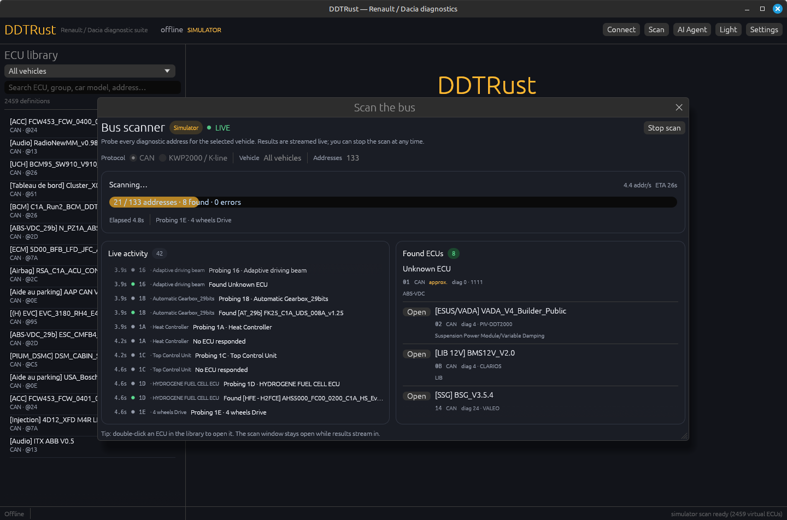
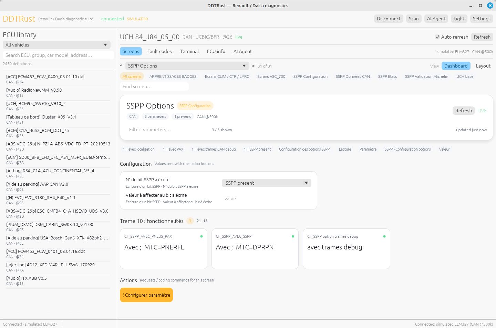

# DDTRust

**A modern Rust rewrite of [ddt4all](https://github.com/cedricp/ddt4all)** — Renault, Dacia and Nissan
diagnostics over an ELM327 adapter, with the same ECU database, live parameter screens and fault-code
support, but a native Rust core, a headless CLI and a modern egui desktop application.



> **Data is not included.** DDTRust does not redistribute `ecu.zip` or an extracted ECU database.
> Supply your own copy (see [DATA.md](DATA.md)); everything else needed to build and run is in this
> repository.

DDTRust reads ddt4all's own `ecu.zip` database directly. Every vehicle, ECU definition, parameter,
request and screen layout is data-driven — nothing is hard-coded per car.

## Highlights

- 🚗 **2,459 ECU definitions / 185 vehicles** from the ddt4all database, with exact and approximate
  identification (UDS DIDs `F1A0/F18A/F194/F195` and legacy `2180` records).
- 🔌 **CAN (11/29-bit, 250/500 kbit/s) and KWP2000/ISO8** over a real ELM327 (serial or Wi-Fi/TCP),
  plus **CandleLight/SocketCAN** on Linux for CAN-only diagnostics.
- 🧮 **Bit-exact parameter codec**: scaling, offsets, divisors, signed values, enums, ASCII, bit
  offsets, big/little endian and multiple-byte fields — validated against the original Python code.
- 📈 **Two screen views generated from ddt4all `.layout` JSON**:
  - **Dashboard** (default) — a responsive card grid with grouped requests, parameter search,
    large values, units, freshness indicators, update flashes, live sparklines, configuration
    forms and modern actions.
  - **Layout** — the original pixel-positioned ddt4all screen, preserving car-specific diagrams,
    colour panels and absolute widget placement. Layouts open automatically zoomed to fit the
    window width (tall layouts scroll vertically); **Fit width**, **1:1** and a zoom slider remain
    available.
  Both views share the same live data and support displays, inputs, buttons, pre-send requests,
  labels and animated GIF graphics.
- 🤖 **Built-in AI Agent** (OpenAI-compatible): ask about the current ECU, interpret DTCs, inspect
  live values, search the database by car model and navigate screens through read-only tools.
- 🧾 **DTC read/clear** with per-record field decoding and ECU-specific device names.
- 📡 **Live bus scanner** with streaming activity, progress/ETA, found-ECU cards and cancellation.
- 📡 **Bus scanner** for CAN and KWP with exact/approximate matching.
- 🧪 **Built-in ECU simulator**: explore every screen, scan a virtual vehicle and test the whole
  stack without a car. The simulator speaks the real ELM327 ASCII protocol and ISO-TP framing.
- 🖥️ **CLI + GUI** sharing one core; JSON output, CSV recording, raw terminal, monitor mode.
- 🛡️ **Read-only by default** with ddt4all's safe-service set; expert mode unlocks writes.

## Screenshots

| Modern dashboard | Layout (ddt4all) view |
| --- | --- |
|  |  |

| Configuration & actions | Fault codes |
| --- | --- |
|  |  |

Layout-specific graphics (GIF/PNG assets from `ecu.zip`) are rendered in both views:



Screens are generated from the ECU's `.layout` file; the Layout view preserves ddt4all's absolute
positions and colours, while the Dashboard view reflows the same data into cards. All screenshot
data is synthetic because the simulator is active.

## ECU library

The ECU list stays deliberately compact: each row shows the ECU group/name, protocol and address.
Per-ECU vehicle/project code lists are hidden because they make the list unreadable. Double-click a
row to open that ECU (single-click only selects it).

Search still covers them. Type a car model in the search box (`Clio IV`, `Mégane`, `Duster`, …) or a
project code (`X95`, `X07`) to list every ECU used by that model:



## AI Agent

DDTRust includes an **AI Agent** tab (also reachable from the top bar). It is a diagnostic copilot
that sees the currently opened ECU, screen and latest values, and can call read-only tools:

- search the ECU database by ECU name, address, project code or car model;
- list and open screens, and open another ECU;
- read the current screen values, a named request, or the fault memory;
- inspect ECU identification and metadata.

It **cannot** write coding, clear faults, run actuators or perform security access. Those remain
manual, confirmed actions.



Configure it under **AI Agent → Settings** or with environment variables:

```bash
export DEEPSEEK_API_KEY="sk-..."          # default endpoint/model
# optional overrides:
export DDTRUST_LLM_MODEL="deepseek-chat"   # default, tool-capable
export DDTRUST_LLM_ENDPOINT="https://api.deepseek.com/chat/completions"

# local, no key required
export DDTRUST_LLM_ENDPOINT="http://localhost:11434/v1/chat/completions"
export DDTRUST_LLM_MODEL="llama3.1"
unset DEEPSEEK_API_KEY
```

The default provider is **DeepSeek** (`deepseek-chat` at `https://api.deepseek.com/chat/completions`).
Any OpenAI-compatible chat-completions endpoint works (OpenAI, Ollama, vLLM, LM Studio…).
Prompts plus the selected ECU/value context are sent to that endpoint; the API key stays in memory.
Use **Ctrl+Enter** to send. The agent is optional — the rest of DDTRust works without it.

## Adapters



Settings has an explicit adapter chooser with per-adapter configuration:

- **Simulator** — built-in virtual ELM327/ECU; no hardware.
- **ELM327 serial** — detected ports, manual entry and UART baud selection.
- **ELM327 Wi-Fi/TCP** — TCP address.
- **CandleLight / SocketCAN** — Linux CAN interface (e.g. `can0`), CAN bitrate and interface state,
  with the exact `ip link` command needed to bring it up.

### CandleLight / SocketCAN notes

CandleLight uses the Linux `gs_usb` driver and appears as a SocketCAN interface:

```bash
sudo ip link set can0 up type can bitrate 500000
```

The user running DDTRust needs permission to open CAN sockets (run with sufficient capabilities, or
set `CAP_NET_RAW`). DDTRust does not change the interface bitrate itself; make sure the bitrate
matches the vehicle bus. CandleLight is **CAN-only** — KWP2000/ISO8 ECUs that require K-line still
need an ELM327. Windows and macOS are not supported for CandleLight in this build.

## Scanning

The bus scanner is fully live: progress, ETA, current address, per-address activity and found
ECUs stream into the window while the scan runs. You can stop it at any time, and results can be
opened directly from the list.



- CAN and KWP2000 protocols (KWP is disabled for CAN-only CandleLight).
- Live probe log with addresses, groups, no-response and protocol errors.
- Found-ECU cards with exact/approximate identification and identification details.
- Address/speed/error counters, progress bar, elapsed time and ETA.
- Cancel support (stops after the current address).

## Quick start

### Requirements

- Rust **1.95+** (edition 2021)
- Linux, Windows or macOS
- ddt4all's **`ecu.zip`** (or an extracted ECU directory). Place it in the project root, pass
  `--data /path/to/ecu.zip`, or set `DDTRUST_DATA`. DDTRust looks in `./data/ecu`, `./ecu.zip` and the
  user data directory.

### Build

```bash
cargo build --release
```

Binaries:

- `target/release/ddtrust` — CLI
- `target/release/ddtrust-gui` — desktop GUI

### Windows build

A prebuilt 64-bit Windows package is available:

- [DDTRust-0.1.0-windows-x86_64.zip](dist/DDTRust-0.1.0-windows-x86_64.zip)
- SHA-256: `6a6dd9943ba355b86c6127646449b0050f6a64372e290e97ffe5cdb6f7b8f449`

It contains `ddtrust-gui.exe`, `ddtrust.exe`, the license/notice and a Windows quick-start guide.
The binaries are unsigned, so SmartScreen may warn on first launch.



Native Windows builds are also supported from a Windows Rust toolchain:

```bat
rustup target add x86_64-pc-windows-msvc
cargo build --release --workspace
```

CandleLight/SocketCAN is Linux-only; use ELM327 serial or TCP on Windows. See
[docs/WINDOWS.md](docs/WINDOWS.md).

### Run without hardware

```bash
# GUI with the simulator; optionally auto-open an ECU and a screen
cargo run -p ddtrust-gui --release -- --simulate --ecu UCH_84_J84_05_00 --screen "SSPP Options"

# Start in the original ddt4all layout instead of the dashboard
DDTRUST_VIEW=layout cargo run -p ddtrust-gui --release -- --simulate --ecu UCH_84_J84_05_00

# CLI
cargo run -p ddtrust-cli --release -- --simulate info
cargo run -p ddtrust-cli --release -- --simulate dtc UCH_84_J84_05_00
cargo run -p ddtrust-cli --release -- --simulate read UCH_84_J84_05_00 --screen "Etat E/S Clim_trame_C1"
cargo run -p ddtrust-cli --release -- --simulate scan --vehicle X95
```

### Run on a car

1. Plug an ELM327-compatible adapter into the OBD port and switch the ignition on.
2. In the GUI: **Settings → Adapter**, choose **ELM327 serial** (e.g. `/dev/ttyUSB0`, `COM3`) or
   **ELM327 Wi-Fi/TCP** (e.g. `192.168.0.10:35000`), then select an ECU and press **Connect**.
3. For a **CandleLight** adapter on Linux, bring its SocketCAN interface up first:

   ```bash
   sudo ip link set can0 up type can bitrate 500000
   ```

   Then choose **CandleLight / SocketCAN**, select `can0` and press **Connect**. CandleLight is
   CAN-only; KWP2000/ISO8 K-line ECUs still need an ELM327.
4. Or use the CLI:

```bash
ddtrust --port /dev/ttyUSB0 --baud 38400 ecu UCH_84_J84_05_00
ddtrust --can-interface can0 --can-bitrate 500000 ecu UCH_84_J84_05_00
ddtrust --port /dev/ttyUSB0 scan --vehicle X95
ddtrust --port /dev/ttyUSB0 read UCH_84_J84_05_00 --request "ReadDTC"
ddtrust --port /dev/ttyUSB0 dtc UCH_84_J84_05_00
ddtrust --port /dev/ttyUSB0 --expert raw UCH_84_J84_05_00 --hex "2E F1 00 01"
```

> ⚠️ Writes, coding, actuator tests and security access are blocked unless `--expert` / **Expert mode**
> is enabled. You are responsible for any changes made to a vehicle. Keep a battery charger connected
> for long sessions.

## CLI overview

```
ddtrust [--data PATH] [--port PORT | --tcp ADDR | --can-interface IFACE] [--baud N]
        [--can-bitrate N] [--simulate] [--expert] [--vehicle CODE] [--json] <command>

info                         database + configuration summary
vehicles [--search TEXT]     list vehicle projects
ecus [--vehicle CODE]        list ECU definitions
ecu <href|name>              metadata, identification records, screens
screens <href|name>          list screen categories/screens
scan --protocol can|kwp      scan the bus (or the simulator)
read <ecu> --request NAME    read one request (or --screen NAME for all displays)
dtc <ecu> [--clear]          read or clear fault codes
raw <ecu> --hex HEX | --at CMD
monitor <ecu> --request NAME --interval MS [--count N] [--csv FILE]
sim-serve <ecu> --listen ADDR  expose a simulated ELM327 over TCP
```

Useful global flags: `--json` for machine-readable output, `--vehicle` to restrict the ECU library,
`--data` to select the database. `read` accepts `--input NAME=VALUE` (repeatable), `--count`,
`--interval` and `--csv` for recording.

## How it works

```
┌────────────┐   JSON    ┌─────────────────────────────────────────────┐
│ ecu.zip /  │──────────▶│ ddtrust-core                                │
│ data/ecu   │           │  model: EcuFile, EcuData, Request, Layout   │
└────────────┘           │  value codec (bit-exact ddt4all semantics)  │
                         │  ELM327 driver + ISO-TP + transports        │
┌────────────┐           │  scanner, DTC, EcuSession, safety           │
│ projects.  │──────────▶│  simulator (virtual ECU + emulated ELM327)  │
└────────────┘           └──────────────┬──────────────────────────────┘
                                        │
                       ┌────────────────┴────────────────┐
                       │                                 │
                 ddtrust-cli                        ddtrust-gui
                 (clap)                            (egui + worker thread)
```

More detail: [docs/ARCHITECTURE.md](docs/ARCHITECTURE.md) · [docs/FEATURES.md](docs/FEATURES.md).

## Validation

- The value codec is tested against **golden vectors generated from the original ddt4all Python
  implementation** (`tools/gen_vectors.py`): 140 decode cases, 100 encode cases and 14 full request
  builds, covering big/little endian, bit offsets, signed values, ASCII, enums and scaling.
- A parse test loads **all 2,459 ECU JSON files and all 2,459 layouts** from the ddt4all database
  (run with `cargo test -p ddtrust-core --test real_database -- --ignored`; ~2.5 minutes).
- Simulator integration tests cover ELM327 commands, ISO-TP multi-frame responses, CAN scanning,
  KWP scanning, DTC decoding and safety blocking.

## Compatibility and limitations

Implemented: CAN/KWP scanning, UDS/KWP identification, live screens, DTC read/clear, raw terminal,
CSV recording, adapter configuration, 29-bit CAN, animated screen graphics, simulator, JSON DB.

Not (yet) implemented:

- CandleLight on Windows/macOS (the current implementation is Linux SocketCAN; use ELM327 there).
- SLCAN/Lawicel firmware adapters.
- KWP2000/ISO8 over CAN-only adapters like CandleLight (K-line hardware is required).
- DoIP transport (the protocol is recognised but sessions are unsupported).
- ddt4all's graphical screen/data editors and ECU XML authoring.
- Car-specific plugins (UCH/AB/ EPS resets, VIN scripts) and the macro/command engine.
- CAN bus sniffer view, Bluetooth discovery and adapter-specific STPX/CFC0 quirks.
- Legacy XML ECU definitions — modern ddt4all ships the JSON database used here.

The simulator produces synthetic values; it is a development/demo aid, not a vehicle model.

## Data and license

DDTRust is licensed under **GPL-3.0-or-later**, matching ddt4all.

- ddt4all: Copyright its contributors, GPL-3.0-or-later — <https://github.com/cedricp/ddt4all>
- The bundled `assets/projects.json` (vehicle/addressing metadata) is taken from ddt4all.
- The ECU database (`ecu.zip`) is **not** bundled; use ddt4all's data. It remains under its original
  license.
- This project is an independent rewrite and is not affiliated with Renault, Dacia, Nissan or
  ddt4all's authors. "Renault", "Dacia" and "Nissan" are trademarks of their respective owners.

Use at your own risk. Diagnostics can change ECU configuration; always verify a write read-back and
keep a backup of your configuration.
